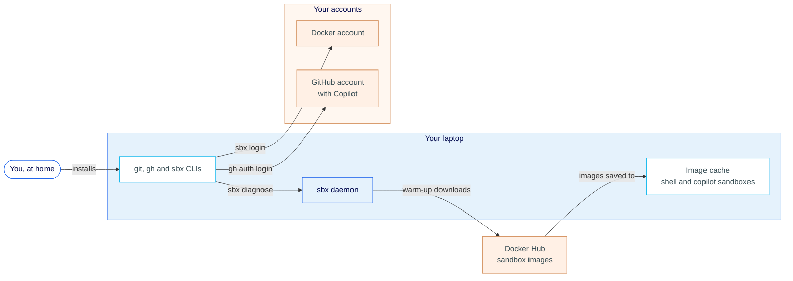

# 📝 Prerequisites

> [!IMPORTANT]
> **Do this page at home, before the meetup.** It installs tools and downloads the sandbox images, several hundred megabytes that take a long time on shared Wi-Fi. It takes about 15 minutes.



## Accounts and tools

- A computer running macOS, Windows, or Linux.
- A **Docker account**. Docker Sandboxes are free to use; [create a Docker account](https://hub.docker.com/signup) if you don't have one.
- A **GitHub account with access to GitHub Copilot**. [Create a GitHub account](https://github.com/signup) and check the [Copilot plans](https://github.com/features/copilot/plans) for the available options. The lab sends about **10 prompts** to the agent, which count against your Copilot usage allowance. In a test run, the Copilot CLI reported between about 3 and 15 **AI Credits** per prompt (shown at the end of each answer), about 75 in total. On **Copilot Free**, whose monthly allowance is small, check in your [Copilot settings](https://github.com/settings/copilot) that you have enough left.
- **Git**, to clone the repository and review the agents' work.
- The **GitHub CLI** (`gh`), signed in to your GitHub account. [Install it](https://cli.github.com/), then run `gh auth login` and verify with:

    ```bash
    gh auth status
    ```

- The **`sbx` CLI**. Follow [these instructions](https://docs.docker.com/ai/sandboxes/install/) to install or update it.

## sbx setup

Every exercise depends on `sbx` running correctly on your computer. **Do not skip this section.**

1. Verify that `sbx` is installed:

    ```bash
    sbx version
    ```

    Expected output: a version string such as `sbx version v0.54.0 <commit>`. The lab was tested with v0.54.0; if your version is older, update `sbx` first.

2. Sign in to Docker (skip this if you are already signed in):

    ```bash
    sbx login
    ```

    Follow the instructions on the screen.

    > [!NOTE]
    > The first time you use `sbx` you may be asked to choose a default network policy. Pick **Balanced** for now; the next module switches you to **Locked Down**.

3. Check that your installation is healthy:

    ```bash
    sbx diagnose
    ```

    Each check is marked ✓ (passed), ✗ (failed) or ⊘ (skipped). The checks under **INSTALLATION**, **PLATFORM** and **CONNECTION** (daemon, virtualization, authentication, global network policy) must pass. A ✗ on an optional item, such as **SSH client config**, does not affect this lab and can be ignored.

4. This lab assumes that your Docker account is **not** subject to organization AI Governance policies. Check the configured policies:

    ```bash
    sbx policy ls
    ```

    Every policy should have `local` as its `SOURCE` (or `kit`, for a policy that applies to a single sandbox you created before). The output looks similar to this:

    ```none
    POLICY             SOURCE   APPLIES TO   SUMMARY
    default-deny-all   local    all          network: deny when no rule decides
    local-policy       local    all          network: 195 allow; filesystem read: 1 allow; filesystem write: 1 allow
    ```

    If you see policies from any other source, your organization restricts what sandboxes can do and some exercises may not work. Use a personal Docker account or ask your administrator for guidance.

5. Clone the lab repository and move into it:

    ```bash
    git clone https://github.com/mathieu-benoit/sbx-lab
    ```

    ```bash
    cd sbx-lab
    ```

    You commit the agents' work locally during the lab, but you never push it, so you don't need a fork. Skip this step if you already have a clone, for example because you started this page with `./labspace-local/start.sh`: its terminal opens in the root of your clone.

6. From the root of the repository, download the two sandbox images the lab uses by creating, then removing, a sandbox of each kind:

    ```bash
    sbx create --name warmup-shell shell .
    ```

    ```bash
    sbx create --name warmup-copilot copilot .
    ```

    ```bash
    sbx rm --force warmup-shell warmup-copilot
    ```

    The images stay on your computer, so the sandboxes you create during the lab start in seconds.

You're all set! At the meetup, start with the next module.

[[Home](../README.md) | [Next >> Network policies](01-network-policies.md)]
