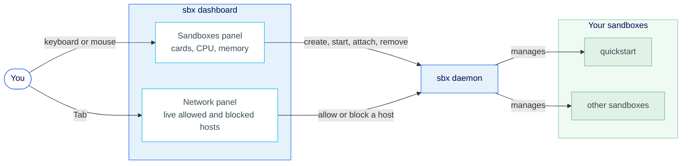

# 💻 The interactive TUI dashboard

Running `sbx` with no arguments opens the TUI (Terminal User Interface).



1. Open the TUI by running the following command on your host, outside of any sandbox:

    ```bash id=host
    sbx
    ```

    The dashboard shows all sandboxes as cards with live CPU and memory usage.

Here are a few useful keyboard shortcuts:

| Key     | Action                                               |
|---------|------------------------------------------------------|
| `c`     | Create a new sandbox                                 |
| `s`     | Start or stop the selected sandbox                   |
| `Enter` | Attach to the agent session (same as `sbx run`)      |
| `x`     | Open a shell inside the sandbox (`sbx exec`)         |
| `r`     | Remove the selected sandbox                          |
| `Tab`   | Switch between the Sandboxes panel and Network panel |
| `?`     | Show all shortcuts                                   |

The **Network panel** (press `Tab`) shows a live log of every outbound connection the sandbox makes — which hosts were reached, which were blocked. Use the arrow keys to navigate the log and allow or block hosts directly. This is the fastest way to debug "why can't my agent install this package?" Look for the `paste.rs` upload you tried in the previous module: it's there, blocked.

**Press `Ctrl-C` and then `Y`** to exit the dashboard without stopping any sandboxes.

For now the dashboard is quiet: only `quickstart` exists, and no agent is working. You'll open it again in [Clone mode and parallel agents](07-parallel-agents.md#parallel-agents), to watch two agents work at the same time.

> [!TIP]
> While you can use the keyboard to navigate around the TUI, it also has full mouse support!

[[<< Previous: Agent sandbox](04-first-sandbox.md) | [Next >> Run in direct mode](06-run-in-direct-mode.md)]
