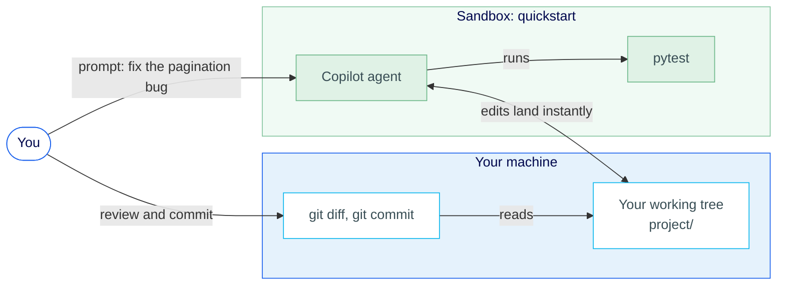

# ⚡ Running in direct mode

In this exercise your agent works in **direct mode**, the default, where its edits land straight in your working tree. You will have it run the test suite, diagnose the failures, fix a bug, and confirm that the tests pass.



1. Reconnect to your sandbox from the `project` directory:

    ```bash id=host
    sbx run --name quickstart
    ```

2. Run the existing test suite by giving your agent the following prompt:

    ```console id=sandbox
    Set up the Python environment for the FastAPI backend and run the test suite.
    Report:
    - Which tests pass
    - Which tests fail, with the full error output
    - Your diagnosis of each failure

    Use pytest with verbose output: cd backend && ~/venv/bin/pytest tests/ -v
    ```

    Python is already in the sandbox, thanks to the kit, so this takes a minute or two. You should see **3 failing tests**, **1 expected failure (`xfail`)**, and all the others passing:

    | Test                                         | Status  | Cause                                       |
    |----------------------------------------------|---------|---------------------------------------------|
    | `test_pagination_first_page_returns_results` | failing | pagination bug                              |
    | `test_pagination_second_page`                | failing | same pagination bug                         |
    | `test_updated_at_changes_on_update`          | failing | `updated_at` never refreshed (next module)  |
    | `test_search_finds_matching_issues`          | xfail   | search not implemented yet (next module)    |

3. Ask your agent to fix the pagination bug by giving it the following prompt:

    ```console id=sandbox
    Two tests are failing because of a pagination bug. Fix it:

    1. test_pagination_first_page_returns_results
    2. test_pagination_second_page

    For each fix:
    - Explain what the bug is and why it causes the failure
    - Show the diff of your change
    - Re-run the specific test to confirm that it passes before moving on
    ```

    While your agent works, open the affected file (`backend/app/routers/issues.py`) in your editor on the host. You will see the agent's edits appear: the workspace mount is bidirectional and instant, with no copy step and no polling delay.

4. Confirm the result by giving your agent the following prompt:

    ```console id=sandbox
    Run the full test suite and report the results.
    ```

    The two pagination tests now pass. `test_updated_at_changes_on_update` still fails (and the search test is still an expected failure): you will deal with those in the next module.

5. Exit the agent session (press **`Ctrl-C` twice**) and review the change on your host:

    ```bash id=host
    git status
    git diff
    ```

    Then commit it. The next module starts agents from your *committed* code, so this fix must be committed:

    ```bash id=host
    git add -A
    git commit -m "Fix pagination offset in list_issues"
    ```

> [!IMPORTANT]
> Installed packages **persist** across agent restarts for this sandbox. If you stop and reconnect to `quickstart`, you won't need to run `pip install` again.

[[<< Previous: TUI dashboard](05-tui-dashboard.md) | [Next >> Clone mode and parallel agents](07-parallel-agents.md)]
