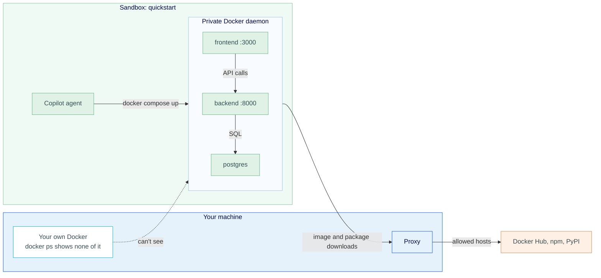

# 🐳 Docker inside the sandbox

Each sandbox has its own private Docker daemon. Your agent can run `docker compose up`, build images, and start containers, and none of them appear in your host's `docker ps`.



1. Go back to the `project` directory (the clone mode module left you at the root of the repository) and reconnect to your sandbox:

    ```bash id=host
    cd project
    sbx run --name quickstart
    ```

2. Give your agent the following prompt:

    ```console
    Start the full application stack using Docker Compose.
    Once everything is healthy:
    1. Confirm the backend API is responding at http://localhost:8000/health
    2. Create a test user via the API
    3. Create a project and two issues for that user
    4. Report the final state (user, project, issues) as JSON

    Use the API docs at http://localhost:8000/docs if helpful.
    Make sure all servers bind to 0.0.0.0 so I can reach them via port forwarding.
    ```

    You will see your agent run `docker compose up --build -d`, wait for the database and backend health checks to pass, then call the API endpoints with `curl` or `httpx`. The first run pulls images and installs the frontend dependencies, so it can take a few minutes.

3. From inside the agent session, list the running containers:

    ```bash id=sandbox
    !docker ps
    ```

    The output looks similar to this:

    ```console
    CONTAINER ID   IMAGE                COMMAND                  CREATED         STATUS                   PORTS                                         NAMES
    a74c644a575f   project-frontend     "docker-entrypoint.s…"   2 minutes ago   Up 2 minutes             0.0.0.0:3000->3000/tcp, [::]:3000->3000/tcp   project-frontend-1
    046609163f75   project-backend      "uvicorn app.main:ap…"   2 minutes ago   Up 2 minutes (healthy)   0.0.0.0:8000->8000/tcp, [::]:8000->8000/tcp   project-backend-1
    f8c2988853b3   postgres:16-alpine   "docker-entrypoint.s…"   2 minutes ago   Up 2 minutes (healthy)   5432/tcp                                      project-db-1
    ```

    Run `docker ps` in another terminal on your host: you won't see these containers there.

4. **Leave the agent session open** and move on to the next module in another terminal.

    > [!IMPORTANT]
    > A sandbox stops when no agent session is attached to it, and its containers and published ports go with it. If you exit the session (`Ctrl-C` twice), restart the sandbox without opening a new session:
    >
    > ```bash id=host
    > sbx run --detach --name quickstart
    > ```
    >
    > The Compose services restart on their own within a few seconds, and published ports are restored.

The containers your agent runs live entirely inside the sandbox. When you remove the sandbox with `sbx rm`, all its images, containers, and PostgreSQL data are deleted too.

[[<< Previous: Clone mode and parallel agents](07-parallel-agents.md) | [Next >> Port forwarding](09-port-forwarding.md)]
