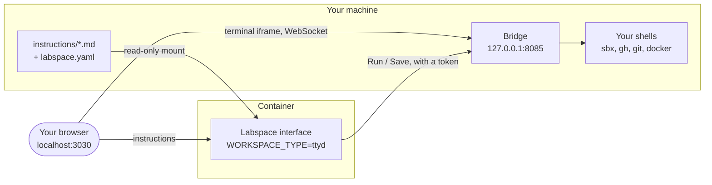

# The lab as a Labspace, with a terminal on your machine

A [Labspace](https://github.com/dockersamples/labspace-infra) rendering of the hands-on lab: the
[instructions](../instructions) on the left, with **Run** buttons, and on the right a terminal that is a real shell
**on your own machine**, not in a container.

A regular Labspace runs its terminal in a VS Code container. That doesn't work for this lab: `sbx` starts microVMs on
your machine, uses your OS keychain and your `gh` login, and the lab compares what you see inside a sandbox with what
your host sees. So the commands must run where `sbx` runs: on your machine.

## Start it

You need the [prerequisites](../instructions/00-prerequisites.md) of the lab, plus **Node.js 20+** and **Docker**.

```bash
./labspace-local/start.sh
```

Then open <http://localhost:3030>. The first run installs the bridge's dependencies and pulls the interface image.
`Ctrl-C` stops everything.

- The shells start in the root of this repository, with your login shell (`$SHELL -l`).
- Each tab is a separate shell. Click **+** for another one, as the lab asks for "another terminal".
- A code block with `terminal-id=<name>` (for example `` ```bash terminal-id=agent-2 ``) runs in the tab of that
  name, and creates it if needed.
- Reloading the page keeps the shells and replays their recent output. They stop when you stop `start.sh`.

## How it works



- **Interface**: the published `dockersamples/labspace-interface` image, unchanged. With `WORKSPACE_TYPE=ttyd`, it
  sends the Run and Save buttons to `$WORKSPACE_API_URL/api/command` and `/api/save` instead of the VS Code
  extension, and shows `http://localhost:8085` in its right panel. Only this container is started: no configurator,
  VS Code workspace, socket proxy or port republisher, which a host terminal doesn't need. The Markdown is mounted
  read-only and re-read on every page load, so you can edit the lab and refresh.
- **Bridge** ([`bridge/server.js`](bridge/server.js)): a small Node.js server on your machine. It serves the terminal
  page (xterm.js), runs one shell per tab with node-pty, and implements the two endpoints the interface calls.
- [`../instructions/labspace.yaml`](../instructions/labspace.yaml) lists the sections.

### Security

The bridge types commands into your shell, so it only accepts what the Labspace sends:

- It listens on `127.0.0.1` only.
- `/api/command` and `/api/save` need a token, generated by `start.sh` on every run and given only to the interface
  container.
- The WebSocket only accepts the terminal page's own origin (`http://localhost:8085`), and every request must name
  the bridge in its `Host` header, so another web page can't drive the shell, even through DNS rebinding.
- The terminal page can only be framed by `localhost:3030`.
- Save writes only under this repository, or under your home folder for paths that start with `~/`.

## Static preview (GitHub Pages)

[`static/build.mjs`](static/build.mjs) builds the same interface as a static site, to see the rendering without
running anything: no container and no bridge. The right panel is a preview that shows what the **Run** and
**Save** buttons would do. The [`labspace-pages`](../.github/workflows/labspace-pages.yaml) workflow publishes it
to GitHub Pages.

```bash
node labspace-local/static/build.mjs --base /sbx-lab/ --out _site
```

It builds the interface client from `dockersamples/labspace-infra` at a pinned commit, with small patches (base path,
preview panel instead of VS Code), writes the sections as JSON files, and adds a script that answers the client's
`/api` calls from them.

## Known limitations

- **Links between modules** (`[Next >> ...](02-kits.md)`) open the raw Markdown in a new browser tab; use the
  section picker or the **Next** button at the bottom instead. The Labspace interface opens every link in a new
  tab.
- **No IDE**: "open file" links do nothing. Use your own editor on the repository.
- **Linux**: node-pty has no prebuilt binary for Linux, so `npm install` compiles it, which needs `python3`, `make`
  and a C++ compiler, and recent npm versions may ask you to approve its install script.
- The interface image is used as `latest`; its `ttyd` workspace mode is recent (April 2026). It also reads a VS Code
  signing key at start-up even in that mode, which is why [`unused-signing.key`](unused-signing.key) is mounted.
- Ports 3030 and 8085 are fixed: the interface always shows `http://localhost:8085` in its right panel.
