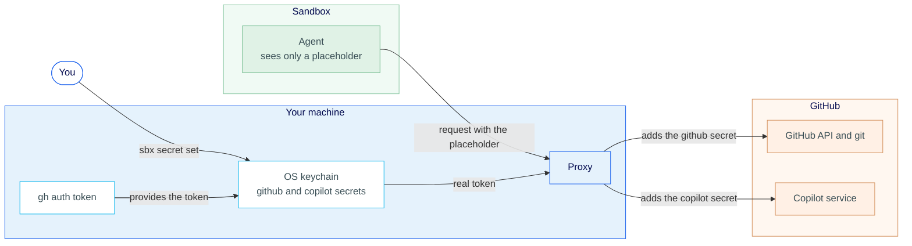

# Secrets and credentials

`sbx` has a built-in secrets manager that stores credentials in your OS keychain, never in plain text on disk or inside the VM. When your agent makes an outbound request that needs authentication, the host-side proxy intercepts it and injects the credential automatically. Your agent can make authenticated API calls but can never read, log, or exfiltrate the raw credential.



Store your GitHub token **now**, before creating the sandboxes your agents will use. Secrets are **global** by default, which means they are available to every sandbox you create. Here the token is resolved from the GitHub CLI each time it is needed:

```bash id=host
sbx secret set github --command 'gh auth token'
```

```bash id=host
sbx secret set copilot --command 'gh auth token'
```

Both use the same token, but for different services: the proxy adds the `copilot` secret to the agent's requests to the Copilot service (`*.githubcopilot.com`), and the `github` secret to its requests to GitHub itself (the GitHub API, `git` over HTTPS).

> **Warning:** if you already stored a global `github` or `copilot` secret for other work, these commands **replace** it, and the cleanup at the end of the lab removes it. Check with `sbx secret ls` first.

> **Important:** global secrets are injected when a sandbox is **created**; they cannot be added retroactively to an existing sandbox. A sandbox-scoped secret (set with `--sandbox <name>`) can be added at any time and takes precedence over the global value for that sandbox.

> **Note:** `gh auth token` requires that you are signed in with `gh auth login` and that the account has access to GitHub Copilot. You can also run `sbx secret set github` without `--command` to be prompted for a token instead.

Check that the credentials were stored (secret values are never displayed):

```bash id=host
sbx secret ls
```

In the next module, you'll look inside your agent's sandbox and see that it only gets a placeholder, never your token.
