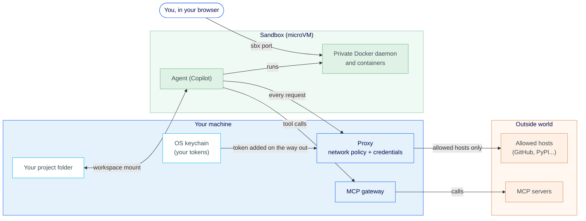

# Docker Sandboxes with GitHub Copilot

Welcome! In this lab you use **GitHub Copilot** inside a [Docker Sandbox](https://docs.docker.com/ai/sandboxes/) to work on **DevBoard**, a small issue tracker (FastAPI + Next.js). Along the way you see how sandboxes keep your machine, your files and your credentials safe while an AI agent does real work.

This is the **simulated** version of the [hands-on lab](https://github.com/mathieu-benoit/sbx-lab): every command runs in your browser, scripted, so there is nothing to install and no Copilot usage allowance to spend. Use it to preview the lab before you take it, to revisit it afterwards, or to follow it without a Docker account.

**Duration:** about 60 minutes.

## What you will learn

- Control what an agent can reach on the network with **network policies**
- Understand how **kits** define an agent's sandbox, and read one you would build
- Give an agent access to services without ever exposing your **credentials**
- Run an agent in **direct mode** and in isolated **clone mode**, and run several agents **in parallel**
- Monitor sandboxes from the **TUI dashboard**
- Run **Docker inside a sandbox** and reach it from your browser with **port forwarding**
- Give your agent tools through the sandbox's **MCP gateway**

## How to use this lab

- **Run buttons.** Every command and prompt in these pages has a **Run** button: it types the block into a terminal and runs it. You can also type it yourself.
- **Four terminals.** The real lab uses several terminals on your laptop: one per agent, one to review and merge their work, one for the dashboard. They are the four tabs on the right, all on the same simulated machine. Use **Terminal 1** until the *Clone mode and parallel agents* module, which tells you when to switch.
- **Agent sessions.** `sbx run` opens an interactive agent session. The terminal prompt changes, and what you type is a prompt for the agent. Leave a session with `/exit` (in the real lab: **Ctrl-C twice**). Inside a session, start a line with `!` to run a shell command without leaving it, for example `!docker ps`.
- **Progress.** Each module lists milestones; they get checked off as you run the right command at the right moment.
- **Stuck?** The **Reset** button puts the simulated machine back to its starting state. Your progress is kept.

> **What is simulated:** the commands and outputs the modules ask you to run. The outputs are modelled on the real lab and abridged in places, so a real `sbx` may format a line differently. Anything else you type answers "this command isn't part of the lab".

## How a sandbox works

A Docker Sandbox is not a container: it's a lightweight **microVM**, with its own kernel, that runs one AI agent. Everything the agent can touch on the way out goes through a few doors that you control from your machine.

| Door | What it means | Module |
|------|---------------|--------|
| **Network proxy** | Every outbound request leaves through a proxy on your machine, which allows or blocks it by host | Network policies |
| **Kit** | A YAML file that says which image the sandbox runs, how the agent starts and what it's given | Kits |
| **Credential injection** | Your tokens stay in your OS keychain; the proxy adds them to the agent's requests, so the agent only ever sees a placeholder | Secrets, Agent sandbox |
| **Workspace** | Only the folder you give the sandbox is shared with it, not the rest of your disk; or the agent gets a private Git clone instead | Agent sandbox, Clone mode |
| **Private Docker daemon** | Containers the agent starts live inside the microVM, invisible to your host's Docker | Docker inside the sandbox |
| **Port publishing** | Nothing inside is reachable from your machine until you publish a port | Port forwarding |
| **MCP gateway** | Tools reach the agent through the gateway, without opening its network. The MCP servers run outside the sandbox, so its network policy doesn't apply to them: register only servers you trust | MCP servers |

Because the agent can't step outside these doors, you can let it work without approving every command (`--yolo`), and still know what it can and can't reach.

Ready? Open **Prerequisites** in the menu.
